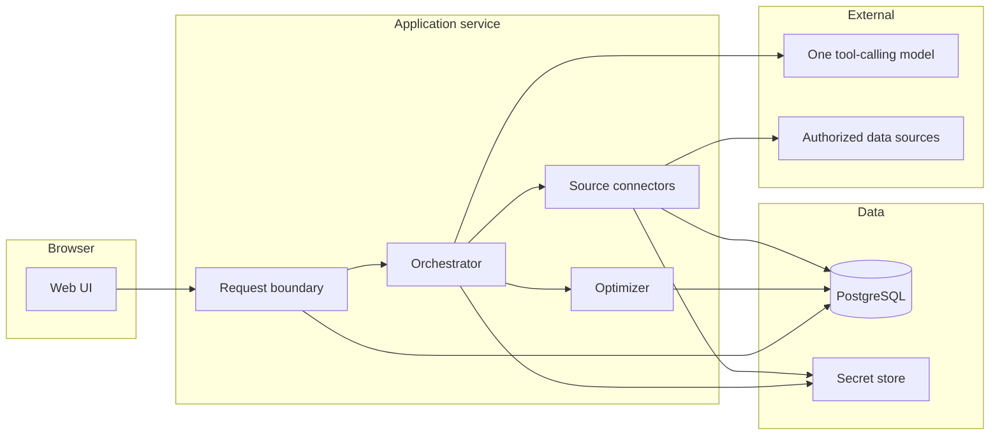

# Architecture

**Status:** Draft for specification review
**Updated:** 2026-10-11

This document defines components and flows for the MVP. Stack choice and trade-offs are in [ADR-001](../adr/001-initial-stack.md). Data rights are in [ADR-002](../adr/002-grocery-data-strategy.md). Normative product behavior stays in [product-requirements.md](product-requirements.md).

## Proposed system

The MVP is one web application and one PostgreSQL database. A single orchestrator calls a small set of tools. Basket math is ordinary application code. A scheduled job refreshes authorized source snapshots. There is no queue service, no agent framework cluster, and no checkout service in the first release.



### Decision DEC-ARC-001. One orchestrator

The language model is one orchestrator with tool calling. Tools are deterministic modules: profile, location, store search, offer search, normalization, and optimization. The model selects tools and writes explanations from tool output. It does not own prices.

A multi-agent design would add handoff state, extra model calls, and more ways for untrusted flyer text to steer a second model. The MVP does not have a task that needs that split. A later agent is justified only when a capability has its own lifecycle, its own evaluation, and a reason it cannot be a tool. That case is not present now.

### Decision DEC-ARC-002. Deterministic optimization

`CMP-OPT` is a pure function of its input document plus the offer rows it is given. The model may call it and may explain the returned JSON. The model may not adjust totals in prose that the UI then treats as the total. The UI renders totals from the optimizer record.

### Decision DEC-ARC-003. One deployable application

Request handling, orchestration, optimization, and connectors ship as one codebase and one web service. A separate worker process is added only if the proof of concept shows that source refreshes or model waits exceed the web process limits. The data model already has workflow state, so a worker can resume a run without a redesign.

## Component responsibilities

| ID | Component | Responsibility |
| --- | --- | --- |
| CMP-WEB | Web UI | Onboarding, consent, request, clarification, review, approval. Renders server state. Does not calculate totals. |
| CMP-API | Application boundary | Sessions, input validation, household authorization, workflow commands. The only browser entry to plans and approvals. |
| CMP-ORCH | Orchestrator | Runs the state machine. Calls the model for language. Dispatches tools. Persists pauses. Enforces the model-call cap (NFR-008). |
| CMP-MODEL | Model adapter | One provider, behind an interface: messages in, tool calls out, explanation text out. Swappable after the ADR-001 spike. |
| CMP-PROFILE | Profile tool | Reads and updates household preferences. Returns only the fields the workflow needs. |
| CMP-LOC | Location tool | Validates postal codes. Applies consent. Resolves stores' required precision. |
| CMP-STORE | Store tool | Queries authorized store records for a location. Applies the coverage gate (FR-024). |
| CMP-OFFER | Offer tool | Reads current offers for needs from stored snapshots. Filters licence status and freshness. |
| CMP-NORM | Normalization | Parses package sizes into mass, volume, or count. Emits uncertainties instead of guesses when parsing fails. |
| CMP-OPT | Optimizer | Produces the basket, baselines, and exclusion reasons. Specification: [optimization.md](optimization.md). |
| CMP-CONN | Connectors | Pull authorized sources into snapshot tables. One module per source. No connector ships without a licence status of `authorized`. |
| CMP-JOB | Scheduler | Triggers connector refreshes and expiry sweeps. Lightweight cron, not a distributed workflow engine. |
| CMP-DB | PostgreSQL | System of record for users, preferences, snapshots, plans, and approvals. Schema: [data-model.md](data-model.md). |
| CMP-AUTH | Authentication | Email link sign-in and session issuance. Provider selected in ADR-001. |
| CMP-OBS | Observability | Workflow-scoped logs and metrics. Redaction rules: NFR-004. |

## Request and data flow

```mermaid
sequenceDiagram
  actor User
  participant UI as CMP-WEB
  participant API as CMP-API
  participant ORCH as CMP-ORCH
  participant Model as CMP-MODEL
  participant Tools as Tools
  participant OPT as CMP-OPT
  participant DB as CMP-DB

  User->>UI: Restock request
  UI->>API: Create plan draft
  API->>DB: status = draft
  API->>ORCH: Start run
  ORCH->>Model: Interpret request with tool list
  Model->>ORCH: Tool call get_profile
  ORCH->>Tools: get_profile
  Tools->>DB: Load preferences
  ORCH->>User: Clarifying question when HITL requires it
  User->>API: Answer
  ORCH->>Tools: search offers from snapshots
  ORCH->>OPT: Needs, offers, mode, constraints
  OPT->>DB: Optimization result
  ORCH->>Model: Explain this result JSON
  Model->>ORCH: Explanation text
  API->>UI: Review model
  User->>API: Approve this plan hash
  API->>DB: Approval record
```

Offer search reads the application's snapshot tables. The request path does not call an unofficial scraper and does not invent a price. A weekly flyer may later be read by the model from the retailer's own flyer page, as described in [ADR-002](../adr/002-grocery-data-strategy.md). That reading is not authorized yet. If it is authorized, the page is stored as a snapshot and checked before the optimizer treats a price as current.

Explanations are generated after optimization. The prompt for that step includes the optimizer JSON and an instruction to refuse numbers that are not in the JSON. The UI still displays the JSON fields, not amounts parsed back out of the paragraph.

## Frontend and backend boundary

| In the browser | On the server |
| --- | --- |
| Rendering, forms, consent controls | Authorization, workflow transitions, optimizer, connectors |
| The postal code the user typed | Source tokens, database credentials, model keys |
| Display of a plan the server already computed | Decision to mark a plan approved |

The browser sends commands (`answer`, `edit`, `approve`) and receives view models. It does not send a computed total for the server to trust. Approval sends the plan version identifier. The server recomputes the hash from stored rows and rejects a mismatch (FR-017).

Server-side rendering or an equivalent server view model is preferred so secrets and draft offer rows are not assembled in client code. The exact framework is ADR-001.

## AI orchestration design

### Tools the model may call

| Tool | Effect |
| --- | --- |
| `get_profile` | Read household preferences and staples. |
| `update_profile` | Persist a change the user confirmed. |
| `ask_user` | Move to `needs_input` with a structured question. This ends the model turn. |
| `resolve_location` | Validate code or session location against consent. |
| `find_stores` | Return authorized stores or the coverage gate. |
| `search_offers` | Return offers already ingested for the needs. |
| `optimize` | Run `CMP-OPT` and store the result. |
| `explain` | Draft a short explanation from the stored result. Optional for the UI; numbers on screen come from the result. |

The model has no tool for payment, retailer login, deletion of audit records, or setting `approved`.

### What makes the workflow agentic

The workflow is agentic because one orchestrator interprets a goal, chooses tools, pauses when information is missing, evaluates whether the evidence is strong enough to optimize, and returns control for approval. A single chat reply with no tool use and no persisted state is not this workflow. A fixed pipeline with no pause is not this workflow either.

One orchestrator is enough. Meal planning, recurrence, and aisle order do not justify extra autonomous agents. They are later capabilities that would be additional tools if they are ever specified. See DEC-ARC-001.

### Capability table

| Capability | Input | Tool or data | Processing | Output | AI or deterministic | Human approval |
| --- | --- | --- | --- | --- | --- | --- |
| Goal interpretation | Restock text, saved staples | `get_profile` | Schema-validated needs | Editable need list | AI, then user edit | User confirms the list before research is complete (FR-007) |
| Clarification | Missing mode input, ambiguous product, conflict | `ask_user` | Select a HITL question. Do not guess | `needs_input` | AI chooses the question. The HITL list is fixed | The answer is the approval of that decision |
| Location | Consent and postal code or device location | `resolve_location` | Format check and consent | Place at the allowed precision | Deterministic | HITL-007 before device location |
| Store research | Place, coverage configuration | `find_stores` | Authorized stores only | Store list or coverage gate | External data plus deterministic filter | User may pin or hide a store |
| Offer retrieval | Needs, pinned snapshots | `search_offers` | Drop unlicensed, stale, and uncertain rows from the guaranteed set | Offer set with provenance | External data plus deterministic freshness rules | None until review |
| Weekly flyer reading | Official flyer page, if DAT-OQ-009 passes | Future reader. Not built | Model proposes fields. A check against the page is required | Candidate offers, or `uncertain` | Hybrid. Not authorized yet | Prices stay out of the total until checked |
| Normalization | Package text | `CMP-NORM` | Mass, volume, or count. Unknown stays unknown | Variant dimensions | Deterministic | None |
| Hard constraints | Constraints, source attributes | Inside `CMP-OPT` | Remove violations. Unknown allergen is not "safe" | Eligible candidates | Deterministic | HITL-005 or HITL-008 when nothing remains or the request conflicts |
| Basket optimization | Needs, offers, mode, cap | `optimize` | Integer-cent objective in [optimization.md](optimization.md) | Basket, exclusions, hash | Deterministic | Required before the plan is final |
| Explanation | Optimizer JSON | `explain` | Language only. No new amounts | Short rationale | AI | The user approves the plan, not the paragraph |
| Approval | Plan version and hash | Approval command | Compare hash. Ignore model text | `approval_record` | Deterministic | Explicit control (FR-017) |

### Workflow steps

| Step | Class |
| --- | --- |
| User goal | Human |
| Understand the grocery need | AI, then human edit |
| Identify items | AI draft from text and staples. Human confirms |
| Retrieve current grocery data | External authorized data. Weekly flyer reading is hybrid and not authorized yet |
| Normalize products, sizes, and units | Deterministic |
| Filter hard constraints | Deterministic |
| Compare stores and deals | Deterministic over retrieved offers |
| Generate and optimize the basket | Deterministic |
| Evaluate uncertainty | Deterministic freshness and eligibility rules |
| Explain the result | AI, numbers copied from the result |
| Human approval | Human |
| Final shopping plan | Deterministic state change. No purchase |

### Workflow states

`draft`, `needs_input`, `researching`, `optimizing`, `review`, `approved`, `blocked`, `abandoned`.

Transitions are those in the state diagram in [user-journeys.md](user-journeys.md). Illegal transitions fail the command. In particular, `approved` is reachable only from `review` through the approval command.

### What the model is for

- Turn a restock sentence into structured needs, which the user can edit.
- Decide which clarifying question matches the HITL list.
- Explain a finished result in plain language.

### What the model is not for

- Prices, unit prices, eligibility, totals, or savings.
- Deciding that a dietary constraint can be ignored.
- Final approval.
- Asserting that a store or offer exists when the tool returned none.

Structured extractor output is schema-validated. A need without a name is rejected. Quantities that do not parse become questions, not zeros.

## Error handling, retries, and observability

| Failure | Behavior |
| --- | --- |
| Model timeout or malformed tool call | Retry once. Then move to `blocked` with a user-visible retry. Do not apply a partial tool argument. |
| Model calls a tool that does not exist or passes invalid arguments | Reject the call, count it toward the cap, and continue only if the orchestrator can form a valid question or a block. |
| Connector HTTP error or timeout | Retry twice with backoff. Then record a source-run failure and follow FR-020. |
| Connector returns a price without provenance fields | Store it as `uncertain` or reject it at ingest. It cannot become a guaranteed line. |
| Optimizer throws | The plan stays out of `review`. No total is shown. The error is logged with the workflow id. |
| Approval hash mismatch | Reject approval. Keep the user on review for the current version. |
| User repeats a command | Idempotent for the same plan version and inputs hash (NFR-009). |

Logs include workflow id, state, tool name, source id, latency, result counts, and error class. They exclude email, precise coordinates, session tokens, partner tokens, and raw model prompts. Prompt bodies may be stored in a restricted debug store for a short period during the proof of concept, off by default in the pilot, and covered by the retention note in [privacy-security.md](privacy-security.md).

Metrics: run count by terminal state, source success ratio, optimizer duration, approval count, and constraint-exclusion count. These support SM-001 through SM-008. They are not a claim that dashboards already exist.

## Deployment and hosting approach

**Proposed shape.** One container or Node service for the web application, managed PostgreSQL, managed email-link authentication, a secret store provided by the host, and one cron schedule for refreshes.

Environments:

| Environment | Data |
| --- | --- |
| Local | Developer database, synthetic fixtures, no partner tokens required |
| Preview | Synthetic or contracted sample data, clearly labeled |
| Pilot | Authorized snapshots for the cleared region only |

Preview and pilot credentials differ. Preview cannot read pilot source tokens.

The hosting vendor is not settled. ADR-001 compares a long-running Node host with a serverless host because research runs and scheduled refreshes fit a long-running process more simply. No cloud project is created as part of this specification.

Canadian data residency for personal information is an open validation (ARC-OQ-001), not a claim that a chosen vendor already places the database in Canada.

## Rationale for a small MVP

The product risk is data rights and price correctness, not a shortage of services. A correct optimizer over a licensed snapshot is a useful pilot. A larger platform with unlicensed prices is not.

Keeping one application, one database, one model, and one scheduler means:

- Workflow state is visible in one table.
- Money tests run without network access.
- A source can be added as a connector without adding an agent.
- Operational cost stays near the database, the model calls, and the data licence.

The design grows by adding a connector or extracting the worker. It does not require a rewrite of plan state or approval records to do that.

## Open questions

| ID | Question |
| --- | --- |
| ARC-OQ-001 | Which host and which database region will hold personal data for the pilot? |
| ARC-OQ-002 | Does the proof of concept stay inside one web process, or does refresh duration force a worker? |
| ARC-OQ-003 | Which model vendor meets the tool-calling and cost spike? |
| ARC-OQ-004 | Is a geocoder required in the pilot, or is postal-code entry the only location path until a processor is named in the privacy notice? |
| ARC-OQ-005 | Where do workflow logs live, and under what data-processing terms? |
