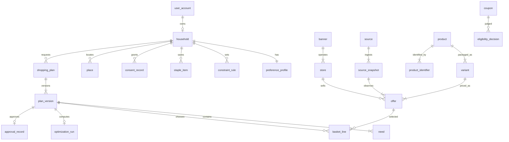

# Data model

**Status:** Draft for specification review
**Updated:** 2026-10-11

Logical model for PostgreSQL. Physical types can be adjusted in implementation. Money is integer Canadian cents (NFR-001). Timestamps are `timestamptz`. Identifiers are UUIDs. This document does not create a database.

Normative behavior that uses these entities: [product-requirements.md](product-requirements.md), [optimization.md](optimization.md), [privacy-security.md](privacy-security.md).

## Conventions

- `licence_status`: `research_only`, `authorized`, `rights_blocked`.
- `freshness`: `current`, `expiring`, `stale`, `uncertain`.
- `eligibility`: `eligible`, `ineligible`, `not_established`.
- Deletes of a user follow PRV-007 and cascade through household-owned rows. Source catalog rows that are not personal are retained.
- Synthetic fixtures use `environment = test` and `licence_status` other than `authorized`, so FR-025 holds even if a fixture is loaded by mistake.

## Users and household preferences

### ENT-001 `user_account`

| Column | Notes |
| --- | --- |
| `id` | Primary key |
| `email` | Unique, stored for sign-in |
| `auth_subject` | Provider user id |
| `created_at`, `deleted_at` | Deletion is a workflow, then a hard delete |

### ENT-002 `household`

One per account in the MVP (FR-002).

| Column | Notes |
| --- | --- |
| `id` | Primary key |
| `owner_user_id` | Foreign key to `user_account` |
| `display_name` | Optional label |
| `household_size` | Integer, optional |
| `created_at` | |

### ENT-003 `preference_profile`

| Column | Notes |
| --- | --- |
| `id` | |
| `household_id` | Unique in the MVP |
| `priority_mode` | `budget`, `quality`, `balanced` |
| `budget_cents` | Nullable |
| `budget_label` | Trip, week, or other. See PRD-OQ-004. |
| `allow_unbounded_budget` | Boolean, default false |
| `max_stores` | Integer, default 1 |
| `allow_brand_substitution` | Default false. Per-need overrides live on needs. |
| `updated_at` | |

### ENT-004 `constraint_rule`

Hard constraints (FR-012).

| Column | Notes |
| --- | --- |
| `id` | |
| `household_id` | |
| `kind` | `allergen`, `ingredient`, `diet`, `brand` |
| `value` | Normalized token, for example `peanut` |
| `hardness` | MVP writes `hard` only |

### ENT-005 `quality_attribute`

Named attributes for quality and balanced modes. Examples: `brand:beatrice`, `label:organic`. The application does not invent attributes the user did not set.

### ENT-006 `staple_item`

Saved restock line: display name, optional GTIN, default quantity, substitution policy for that staple.

### ENT-007 `consent_record`

| Column | Notes |
| --- | --- |
| `household_id` | |
| `purpose` | `device_location`, `store_postal_code`, `save_preferences` |
| `state` | `granted`, `denied` |
| `policy_version` | |
| `recorded_at` | |

## Stores and locations

### ENT-008 `place`

| Column | Notes |
| --- | --- |
| `id` | |
| `household_id` | |
| `postal_code` | Normalized `A1A1A1` when a full code is required |
| `precision` | `postal_code` or `coordinates` |
| `latitude`, `longitude` | Nullable. Written only when PRV-002 allows storage. |
| `geocoder_name` | Nullable. Set when a processor converted coordinates. |
| `updated_at` | |

### ENT-009 `banner`

Retail brand as supplied by an authorized source: `name`, `operator_family` (nullable text, not a claim of corporate accuracy), `source_id`.

### ENT-010 `store`

| Column | Notes |
| --- | --- |
| `id` | |
| `banner_id` | |
| `source_store_key` | Unique with `source_id` |
| `source_id` | |
| `name` | |
| `postal_code` | Nullable if the source uses a zone |
| `province_code` | |
| `latitude`, `longitude` | Nullable, source-provided |
| `service_area` | Optional FSA list or polygon reference |
| `licence_status` | |

A store appears in discovery only when `licence_status = authorized` and the coverage configuration includes it (FR-006, FR-024).

### ENT-011 `coverage_region`

Pilot configuration: name, postal-code or FSA predicate, `enabled` flag, evidence note, and the source ids that justify it. Empty `enabled` set means every user hits the coverage gate.

## Products and identifiers

### ENT-012 `product`

Canonical product family: brand, name, and category when known. Rows can be created from an authorized product source or from an offer that has not yet been matched.

| Column | Notes |
| --- | --- |
| `id` | |
| `brand` | Nullable |
| `name` | |
| `category_code` | Nullable internal code |
| `match_status` | `matched`, `source_only` |
| `created_from_source_id` | |

### ENT-013 `product_identifier`

| Column | Notes |
| --- | --- |
| `product_id` | |
| `scheme` | `gtin`, `upc`, `source_sku`, `off_code` |
| `value` | |
| `source_id` | |

Unique on (`scheme`, `value`, `source_id`).

### ENT-014 `product_attribute`

Source-backed attributes used for constraints and quality: allergens, ingredients, diet labels, organic flag. Each row has `source_id` and `observed_at`. An attribute without a source is not stored. The optimizer treats a missing allergen declaration as unknown, not as safe (see optimization).

## Variants and package sizes

### ENT-015 `variant`

A sellable package.

| Column | Notes |
| --- | --- |
| `id` | |
| `product_id` | |
| `source_id` | |
| `source_variant_key` | |
| `package_text` | Original text, for display |
| `dimension` | `mass`, `volume`, `count`, `unknown` |
| `quantity_base` | Integer. Grams, millilitres, or each. Null when `unknown`. |
| `parsed` | Boolean |

Unit-price ranking ignores `dimension = unknown` (FR-011).

## Prices and promotions

### ENT-016 `source`

| Column | Notes |
| --- | --- |
| `id` | Stable code, for example `statcan-1810024501` |
| `name` | |
| `kind` | `open_data`, `licensed`, `authenticated_user`, `website`, `unofficial` |
| `licence_status` | |
| `licence_note` | Human-readable duties, such as attribution. No secrets. |
| `refresh_sla_hours` | Nullable |

### ENT-017 `source_snapshot`

One ingest result.

| Column | Notes |
| --- | --- |
| `id` | |
| `source_id` | |
| `started_at`, `finished_at` | |
| `status` | `succeeded`, `failed`, `partial` |
| `error_class` | Nullable |
| `environment` | `test`, `preview`, `pilot` |

### ENT-018 `offer`

A price observation for a variant at a store or zone.

| Column | Notes |
| --- | --- |
| `id` | |
| `snapshot_id` | |
| `source_id` | |
| `store_id` | Nullable when the source is zone-level |
| `zone_key` | Nullable postal or flyer zone |
| `variant_id` | |
| `price_type` | `regular`, `promo`, `loyalty`, `coupon` |
| `price_cents` | |
| `currency` | `CAD` |
| `valid_from`, `valid_to` | Nullable. Null `valid_to` forces `uncertain` for guaranteed totals. |
| `observed_at` | |
| `conditions_text` | Source text, untrusted |
| `freshness` | Set by the freshness job and recomputed at read |
| `environment` | Copied from the snapshot |

Unique lookup for a plan: the latest `current` offer per (`variant_id`, `store_id` or `zone_key`, `price_type`) inside a snapshot the run pinned.

### ENT-019 `promotion`

Optional parent of promotional offers: name, `valid_from`, `valid_to`, multi-buy quantity, multi-buy price cents, limit per household if stated. Offers point at `promotion_id` when they come from a deal rather than a plain shelf price.

## Coupons and eligibility

### ENT-020 `coupon`

| Column | Notes |
| --- | --- |
| `id` | |
| `source_id` | |
| `code` | Nullable. Not a user secret; it is a published code if the source publishes one. |
| `discount_type` | `amount_off`, `percent_off`, `fixed_price`, `multi_buy` |
| `amount_cents` or `percent` | One of them, checked by a constraint |
| `min_spend_cents`, `min_quantity` | Nullable |
| `valid_from`, `valid_to` | |
| `stackable` | Boolean, default false |
| `requires_membership` | Boolean |

### ENT-021 `coupon_requirement`

Item, banner, or store predicates. A coupon with an empty requirement set is `not_established`, not universally valid.

### ENT-022 `eligibility_decision`

Computed per user, coupon or loyalty offer, and plan version.

| Column | Notes |
| --- | --- |
| `household_id` | |
| `offer_id` or `coupon_id` | |
| `plan_version_id` | |
| `status` | `eligibility` values |
| `reason` | Machine code, for example `membership_not_connected` |
| `decided_at` | |

The MVP writer emits `not_established` for every loyalty and member coupon (FR-022).

## Shopping lists and basket items

### ENT-023 `shopping_plan`

| Column | Notes |
| --- | --- |
| `id` | |
| `household_id` | |
| `status` | Workflow states in [architecture.md](architecture.md) |
| `workflow_id` | |
| `priority_mode` | Copied at run start |
| `budget_cents` | Nullable copy |
| `created_at` | |

### ENT-024 `plan_version`

Immutable once an optimizer result is attached. Edits insert a new version (FR-021).

| Column | Notes |
| --- | --- |
| `id` | |
| `plan_id` | |
| `version_number` | |
| `inputs_hash` | |
| `content_hash` | Hash covered by FR-017 |
| `created_at` | |

### ENT-025 `need`

A requested line on a version: free-text label, optional product or GTIN, quantity, substitution policy, resolution status (`open`, `met`, `unmet`).

### ENT-026 `basket_line`

Chosen offer for a need.

| Column | Notes |
| --- | --- |
| `plan_version_id` | |
| `need_id` | |
| `offer_id` | |
| `store_id` | |
| `quantity` | |
| `line_total_cents` | |
| `unit_price_display` | Preformatted rational result for the UI |
| `substitution_class` | Nullable. Classes in [optimization.md](optimization.md). |
| `included_in_guaranteed_total` | Boolean |
| `exclusion_reason` | Nullable |

### ENT-027 `excluded_offer`

Offers shown as evidence but kept out of the total: stale, uncertain, constraint failure, ineligible coupon. Includes `reason_code`.

## Optimization results and approvals

### ENT-028 `optimization_run`

| Column | Notes |
| --- | --- |
| `id` | |
| `plan_version_id` | |
| `optimizer_version` | Git revision or semver of the pure function |
| `inputs_hash` | |
| `result_json` | Canonical output the UI renders |
| `created_at` | |

Same `optimizer_version` and `inputs_hash` return the same `result_json` (NFR-009, FR-013).

### ENT-029 `approval_record`

| Column | Notes |
| --- | --- |
| `id` | |
| `plan_version_id` | Unique. One approval per version. |
| `user_id` | |
| `content_hash` | Must equal the version hash at approval time |
| `approved_at` | |
| `statement` | Fixed text the button represented, for example `Approved shopping plan. No purchase placed.` |

### ENT-030 `source_run_error`

Workflow id, source id, error class, attempt count, `created_at`. Supports FR-020.

## Relationships

## Indexes

| Index | Purpose |
| --- | --- |
| `user_account.email` unique | Sign-in |
| `household.owner_user_id` unique | One household in the MVP |
| `store (source_id, source_store_key)` unique | Idempotent store ingest |
| `product_identifier (scheme, value)` | Match a scan or feed code |
| `offer (variant_id, store_id, price_type, observed_at desc)` | Latest price |
| `offer (valid_to)` | Expiry sweep |
| `offer (freshness, environment)` | Pilot queries for current authorized rows |
| `shopping_plan (household_id, status)` | Resume a draft |
| `plan_version (plan_id, version_number)` unique | Edit history |
| `optimization_run (optimizer_version, inputs_hash)` unique | Replay |
| `approval_record.plan_version_id` unique | One approval |
| `consent_record (household_id, purpose, recorded_at desc)` | Latest consent |
| `coverage_region.enabled` | Gate check |

Row-level security, if the ADR-001 database supports it, restricts household-owned tables by `household_id`. Source catalog tables are readable by the application role and writable by the connector role only.

## Open questions

| ID | Question |
| --- | --- |
| DM-OQ-001 | Are flyer offers stored against `store_id`, `zone_key`, or both when a circular covers many stores? |
| DM-OQ-002 | Is GTIN-14, UPC-A, or both the match key the first feed will actually provide? |
| DM-OQ-003 | How long are unapproved drafts retained before PRV-007's general deletion rule? Proposed assumption: 90 days, then delete. |
| DM-OQ-004 | Does `result_json` duplicate basket lines, or should the UI read only relational rows? Proposed: relational rows are canonical; JSON is the hash input and must be generated from those rows. |
