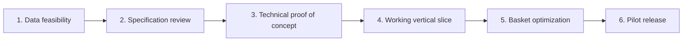

# Roadmap

**Status:** Draft for specification review
**Updated:** 2026-10-11

The sequence below is the path from this specification to a limited pilot. Dates are not assigned. Each phase starts when the previous gate is open. No phase authorizes checkout or unlicensed price collection.

Optimization is specified now and implemented in phase 5 against fixtures before it is pointed at licensed snapshots. Phase 4 proves the workflow with fixture data so the team can see the product before the price feed is real. Phase 4 must not be deployed to users as if the fixtures were deals (FR-025).

## Phase 1. Data feasibility

**Outcome.** A written yes or no on whether one Canadian pilot area can be served with authorized, fresh prices.

**Work.**

- Choose two or three candidate metros only as investigation targets, not as a public launch (PRD-OQ-001).
- Contact or formally review SRC-005 and at least one direct retailer path (SRC-006). Record the answer.
- Complete the rights checklist in [ADR-002](../adr/002-grocery-data-strategy.md) for any source that remains possible.
- Draw a sample for a reference basket. Measure fields, geography, and freshness. Do not estimate coverage without a sample.
- Decide whether SRC-002 can be used for identity given ODbL (DAT-OQ-002).
- Leave SRC-008 unused. SRC-007 is a feasibility question only: whether an AI read of the official weekly flyer page is allowed (DAT-OQ-009). Do not build that reader in this phase.

**Gate G-1.** One source is `authorized` for a named set of postal codes or stores, the sample meets the field list, and the cost is known. If the gate fails, the roadmap stops at a research report. The application is not built around hoped-for access.

## Phase 2. Specification review

**Outcome.** This document set is either accepted with edits or sent back.

**Work.**

- Review open questions that block the pilot: PRD-OQ-001, PRD-OQ-002, DAT-OQ-001, ARC-OQ-001, ARC-OQ-003, SEC-OQ-001.
- Confirm English-only scope against the chosen geography (NFR-007).
- Confirm the optimization examples and TC-OPT cases with a second reader.
- Mark [ADR-001](../adr/001-initial-stack.md) and [ADR-002](../adr/002-grocery-data-strategy.md) accepted or replace the proposals.

**Gate G-2.** A reviewer records acceptance of the requirements, the data gate, and the stack proposal. Unresolved questions that remain are listed as non-blocking.

## Phase 3. Technical proof of concept

**Outcome.** Evidence that the chosen host, database, auth, and model can run the state machine. Still no user-facing real prices.

**Work.**

- Implement the smallest slice of CMP-API, CMP-ORCH, CMP-MODEL, and CMP-DB using synthetic offers.
- Spike tool-calling reliability and cost (ARC-OQ-003, SM-007).
- Measure whether refreshes fit one process (ARC-OQ-002).
- Confirm a database region for personal data (ARC-OQ-001).
- Confirm secrets never appear in the client bundle (AC-042).

**Gate G-3.** The spike notes name the provider, the region, the model cap, and the process model. A failed model spike blocks phase 4 until the adapter can call `ask_user` and `optimize` reliably on fixture tasks.

## Phase 4. Working vertical slice

**Outcome.** A staff user can sign in, enter a postal code, answer a question, and approve a plan built from fixtures in a non-pilot environment.

**Work.**

- Journeys for onboarding, location denial, restock, review, and approval.
- Coverage gate against an empty or limited `coverage_region` table.
- Approval hash and the "model cannot approve" test (AC-023, AC-024).
- Labels that the basket is sample data.

**Gate G-4.** AC-001, AC-007, AC-008, AC-012, AC-015, AC-023, AC-024, AC-026, and AC-033 pass in the preview environment.

## Phase 5. Basket optimization

**Outcome.** The deterministic optimizer matches the specification on fixtures, then on a licensed sample.

**Work.**

- Implement CMP-OPT and CMP-NORM.
- Run TC-OPT-001 through TC-OPT-027 (AC-035).
- Point a connector at the G-1 source in a restricted environment.
- Run AC-053 on the sample before any external user sees a price.

**Gate G-5.** The optimization suite passes, and a sample audit has no unexplained price mismatches. SM-001's ongoing rate starts here.

## Phase 6. Pilot release

**Outcome.** A limited set of users in the cleared region can approve plans from authorized data. Purchasing remains manual.

**Work.**

- Enable coverage only for the G-1 geography.
- Retention, deletion, and isolation tests (AC-048, AC-050).
- Accessibility script for the main path (AC-038).
- Logging redaction check (AC-037).
- Privacy notice names subprocessors (SEC-OQ-001).
- Penetration test or an equivalent independent review required by G-6.

**Gate G-6.** G-1 through G-5 are open. AC-048, AC-050, AC-042, and AC-038 pass. SM-002, SM-003, SM-005, and SM-006 are clean on a staff rehearsal. The independent security review agreed for the pilot is done. Public marketing does not say Canada-wide.

## Dependencies

| Dependency | Blocks |
| --- | --- |
| Authorized price feed | G-1, and therefore every user-facing price |
| Specification acceptance | Implementation beyond a disposable spike |
| Model tool-calling spike | Reliable clarifications |
| Database region decision | Storing personal data in preview or pilot |
| Counsel review of PIPEDA and the first licence | Pilot with external users (PRD-A-002) |
| French UI | Any Quebec coverage region (NFR-007) |
| Loyalty integration | Applying member prices. Explicitly outside the MVP, so it blocks nothing in this roadmap |

## Release gates summary

| Gate | Meaning |
| --- | --- |
| G-1 | Licensed, fresh, sufficient coverage in one named area, or stop |
| G-2 | Specification accepted |
| G-3 | Stack and model spike recorded |
| G-4 | Fixture vertical slice passes the listed acceptance tests |
| G-5 | Optimizer tests and a real sample audit pass |
| G-6 | Pilot safeguards pass, and only the cleared region is enabled |

## Open questions

| ID | Question |
| --- | --- |
| RD-OQ-001 | Who is the accepting reviewer for G-2? |
| RD-OQ-002 | What is the minimum staff rehearsal size before G-6? |
| RD-OQ-003 | If G-1 fails for national banners, is a single-banner pilot still worth running? Proposed: yes, if the rights and the sample pass, and the UI names that banner limit. |
