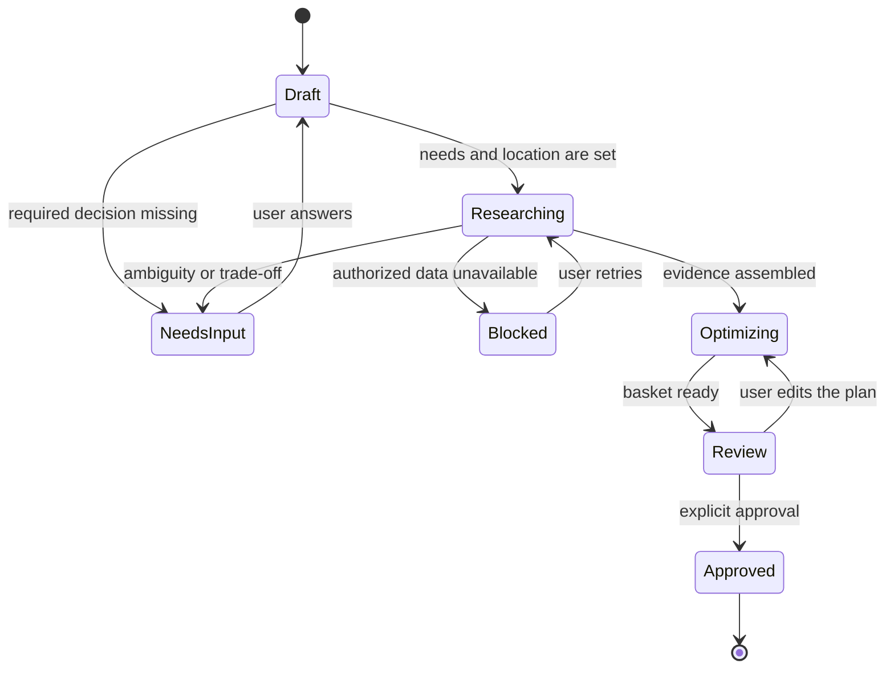

# User journeys

**Status:** Draft for specification review
**Updated:** 2026-10-11

These journeys show how the requirements in [product-requirements.md](product-requirements.md) behave. They do not add requirements. Calculations follow [optimization.md](optimization.md). Which steps are model work, deterministic work, external data, or human decisions is in the workflow table in [architecture.md](architecture.md).

## First-time onboarding

**Requirements:** FR-001, FR-002, FR-003, FR-004, FR-005, HITL-007, PRV-001, US-001

1. Alex opens the web app and creates an account with an email link.
2. The app asks for a household label and household size. It does not ask for children's names.
3. Alex chooses budget-first, enters a trip budget, and records a peanut allergy as a hard constraint.
4. The app explains that location is used to find stores and offers. Alex allows device location for this session and also saves the postal code, which is what the flyer source needs.
5. The app shows stores returned for that postal code, or the coverage-gate message if the postal code is outside the pilot (FR-024).
6. Alex can pin a preferred store and add staple items.
7. The app confirms what it saved and offers a first restock.

If Alex closes the tab during onboarding, the account exists and missing preferences are asked on the next visit. The app does not start research with an empty priority mode.

## Returning user restocking

**Requirements:** FR-003, FR-007, FR-008, FR-013, FR-016, FR-017, US-005

1. Jordan signs in. Saved staples, allergy, preferred store, and budget-first mode are loaded.
2. Jordan types: "I'm running out of groceries. Help me restock."
3. The assistant shows the staple list it intends to use and asks only about items that are ambiguous or missing a quantity (HITL-001).
4. Jordan confirms the list. The workflow enters `researching`, then `optimizing`.
5. The review screen shows the single-store plan, unmet items, provenance, and savings that have a regular-price baseline.
6. Jordan changes one quantity. The optimizer runs again and the plan hash changes.
7. Jordan approves that version. The app shows the final list and states that purchasing stays with Jordan (FR-018).

A later visit remembers the peanut constraint and the preferred store. It does not remember a one-time override unless Jordan chose to update saved preferences (HITL-008).

## Budget-first shopping

**Requirements:** FR-004, HITL-002, FR-011, FR-015, US-002

Alex has budget-first selected and a $80 trip cap.

1. The optimizer filters hard constraints, then chooses the lowest eligible basket that covers the needs inside the cap.
2. When two eligible choices have the same integer-cent line cost, the tie breaks are those in [optimization.md](optimization.md): pre-approved preference, then fewer unresolved substitutions, then source freshness. There is no hidden quality score.
3. If nothing covers the needs inside the cap, the review screen shows the cheapest feasible basket, the amount over cap, and a pause so Alex can raise the cap, drop a need, or allow a substitution (HITL-002). The app does not silently drop the peanut constraint to hit the budget.

**Edge case.** Alex has budget-first saved and removes the cap for one trip. The assistant asks whether to optimize without a cap for this plan only.

## Quality-first shopping

**Requirements:** FR-004, HITL-002, FR-014, US-002

Sam selects quality-first and names the attributes that matter for this household: a preferred yogurt brand, and organic for produce.

1. If Sam had not named any attribute, the run would pause (HITL-002). The app does not treat a higher price as higher quality.
2. For produce, candidates that are not labeled organic by the source are out of the quality set. The cheapest candidate inside that set wins.
3. The review screen still shows the line price and the total. Cost is visible in every mode.
4. If no organic option has a current price, that need is unmet (HITL-005). The assistant does not substitute a conventional item unless Sam accepts it for this plan.

## Balanced shopping

**Requirements:** FR-004, HITL-002, HITL-003, US-002

Jordan selects balanced, keeps a weekly cap, and keeps the named brand preference for milk.

1. The optimizer looks for candidates that satisfy the named quality attributes and the hard constraints, then takes the lowest cost among them.
2. If those candidates exceed the cap, the screen shows the conflict: the cost of keeping the attribute, and the cost of the cheaper candidate that drops it. Jordan chooses. The app does not collapse that choice into an undisclosed weight.
3. A different brand is not added to the approvable plan until Jordan confirms it (HITL-003), unless that brand swap was already allowed for milk.

## Location permission and postal code

**Requirements:** FR-005, FR-006, FR-024, HITL-007, PRV-001, PRV-002, US-003

### Permission granted

1. The app requests browser location only after the explanation screen.
2. Coordinates are used to select a postal code only if a geocoder is configured and named in the privacy notice.
3. If the user has not opted to store coordinates, the app persists the postal code required by the source and drops the coordinates at the end of the request.

### Permission denied

1. The app does not retry the browser prompt in the same session.
2. It asks for a postal code. `M5V 2T6` is accepted. `12345` and `M5V` are rejected with the expected format.
3. Store search runs with the postal code alone.

### Outside the pilot

A valid postal code in a province the project has not cleared still produces the FR-024 unavailable message. The app does not invent stores or prices for that code.

**Open question PRD-OQ-001** chooses the first pilot geography. Until then, every real postal code is outside the cleared set.

## Missing or unavailable products

**Requirements:** FR-012, FR-019, HITL-005, US-012

1. Jordan's list includes a specific cereal.
2. Authorized sources have no current offer, or the only offers fail the peanut constraint.
3. The plan shows the need as unmet, with the reason: no current offer, or constraint exclusion.
4. Jordan can rename the need, allow a substitution class, or leave it off the list.
5. The guaranteed total excludes that need. The screen does not show a guessed price.

## Price verification failures

**Requirements:** FR-010, FR-019, FR-020, US-012

1. During research, one source returns a promotion with a price and no end date.
2. That offer is stored as `uncertain` and kept out of the guaranteed total.
3. A second source times out. The connector retries, then marks that source failed for this run.
4. Lines that still have a current authorized price remain in the basket.
5. Jordan sees which store's data failed and can retry. A retry that returns the same snapshots does not duplicate lines (NFR-009).

If every source required for the region fails, the workflow enters `blocked` and the review total is absent, not zero. A zero total would read as a free basket.

## Shopping-list review and approval

**Requirements:** FR-016, FR-017, FR-018, FR-021, FR-023, HITL-006, US-009

1. The review screen separates three groups: included lines, unmet needs, and excluded uncertain or stale offers.
2. Each included line shows quantity, package size, unit price, line total, store, substitution label if any, and source time window.
3. Savings appear beside a line only with the regular-price baseline (FR-015).
4. Jordan edits a quantity. The included group and the hash update.
5. The approval control names the total and the version. Activating it stores the approval record.
6. The confirmation screen is a shopping list. It has no pay or order control.
7. If Jordan returns after a newer snapshot changes a price, the app asks for approval of the new hash. The old approval stays attached to the old version.

### Edge cases

| Situation | Result |
| --- | --- |
| User approves, then presses approve again | The second request is idempotent for the same hash. |
| Page content or a model reply says the plan is approved | The server state stays unapproved until the approval control succeeds. |
| User deletes the account after approval | Plan and approval records follow PRV-007. |
| Two browser tabs edit the same draft | The later save creates a new version. Approval names the version it signs. |

## Journey-to-requirement index

| Journey | Primary requirements |
| --- | --- |
| First-time onboarding | FR-001, FR-002, FR-003, FR-004, FR-005 |
| Returning restock | FR-007, FR-008, FR-013, FR-016, FR-017 |
| Budget-first | FR-004, FR-011, FR-012, FR-015 |
| Quality-first | FR-004, FR-012, FR-014 |
| Balanced | FR-004, HITL-002, HITL-003 |
| Location and postal code | FR-005, FR-006, FR-024, PRV-001 |
| Missing products | FR-012, FR-019, HITL-005 |
| Verification failure | FR-010, FR-019, FR-020 |
| Review and approval | FR-016, FR-017, FR-018, FR-021, FR-023 |
